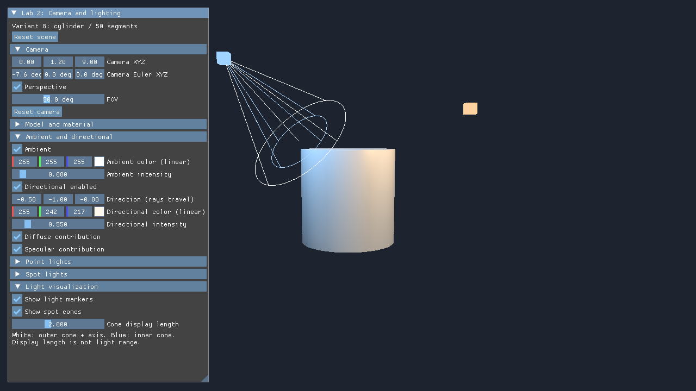
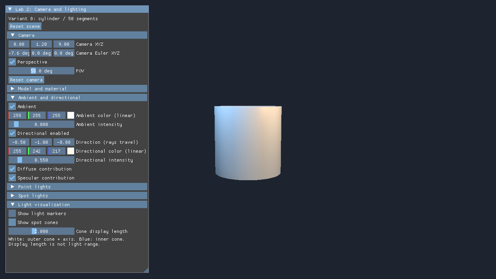
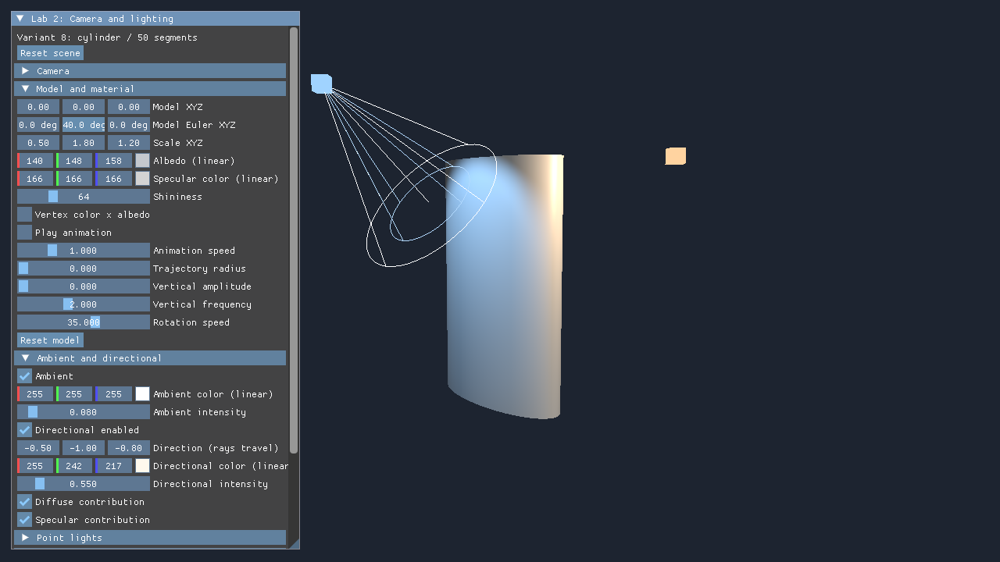

# Черновик отчёта: ЛР2 «Камера и освещение»

Статус: черновик для оформления под требования курса. ФИО, группа, преподаватель и титульный лист не заполнены: эти сведения и образец отчёта не предоставлены. Реальные кадры получены при запуске приложения 01.11.2026; результаты ограничены проверенной средой.

## Условие

Продолжить объект ЛР1 — цилиндр варианта 8 — и реализовать управление камерой, материалом и освещением через ImGui. База: направленный источник и ambient, процедурные нормали, Блинн–Фонг во fragment shader. Дополнения: разделение данных на Scene/Model descriptor sets; динамические массивы point и spot из storage buffers с `1/r²`; мягкие края spot; постоянные цветные маркеры и визуализация конуса с показом/скрытием.

## Метод решения

Программа написана на C++20, Vulkan, GLFW, Dear ImGui, VMA и vk-bootstrap. Независимый проект находится в `lab2`, исходная ЛР1 сохранена по SHA-256. Цилиндр имеет 50 сегментов, 202 записи вершин и 600 индексов. На жёстком ребре крышка и боковина имеют разные нормали.

CPU формирует Model, normal matrix, View и Projection. Освещение рассчитывается в мировом пространстве: diffuse зависит от N·L, specular от N·H в степени shininess. Ambient прибавляется один раз; directional не имеет затухания. Point и spot получают множитель `1/max(r²,0.01)`. Spot использует smoothstep между косинусами внешнего и внутреннего полууглов, а при их совпадении — порог.

В set 0 находятся Scene UBO и два SSBO с runtime-массивами. В set 1 — Model UBO. Память SSBO увеличивается на CPU по мере добавления источников; записи и обновление sets происходят после fence. Для маркеров и line-list конусов созданы отдельные unlit pipelines; их показ не меняет сам свет.

## Результаты

Рисунок 1. Начальная неподвижная сцена: однотонный цилиндр, directional, тёплый point, холодный spot. Белый контур показывает внешний полуугол, синий — внутренний.

Рисунок 2. Оба переключателя визуализации выключены. Свет на цилиндре сохраняется: showMarkers/showCones не являются enabled источников.

Рисунок 3. Через ImGui заданы Scale=(0.5,1.8,1.2) и Rotation Y=40°. Нормали преобразуются inverse-transpose; граница крышки и боковины остаётся жёсткой.

Чистая сборка Debug x64 на MSVC 19.44 завершена успешно. Все четыре шейдера прошли spirv-val. CPU-тест проверил геометрию, матрицы, затухание и граничные условия конуса. Smoke на AMD Radeon(TM) Graphics выполнил 240 итераций, в том числе рост обоих SSBO до 33 элементов, удаления и пустые списки, resize и восстановление окна. Итог: validation_errors=0, general_errors=2, status=0. Вручную выполнены три сворачивания по 500 мс после исправления обработки нулевого extent.

Два general-сообщения относятся к отсутствующим JSON слоёв Steam. Они полностью сохранены в [stderr](docs/smoke-stderr.log); весь лог не объявляется чистым. На NVIDIA и на предельной нагрузке тесты не выполнялись. Полная таблица и команды воспроизведения — в [LAB2_GUIDE](LAB2_GUIDE.md) и [VERIFICATION](docs/VERIFICATION.md).

## Выводы

Реализованы камера, процедурные нормали и Блинн–Фонг для directional, point и spot. Данные разделены по области действия Scene/Model, динамические SSBO не задают максимум источников в GLSL. Визуализация позволяет видеть позиции и направление света независимо от его вклада. Практическая проверка показала важность ожидания fence перед заменой GPU-памяти и обработки minimize до создания swapchain.

Перед окончательной сдачей нужно добавить персональные данные и титульный лист по шаблону курса, проверить требуемое оформление и повторить запуск на компьютере защиты. Этот Markdown не является оформленным финальным DOCX/PDF.
