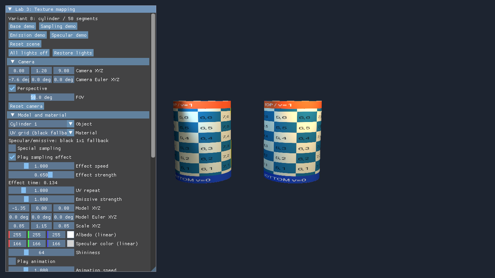
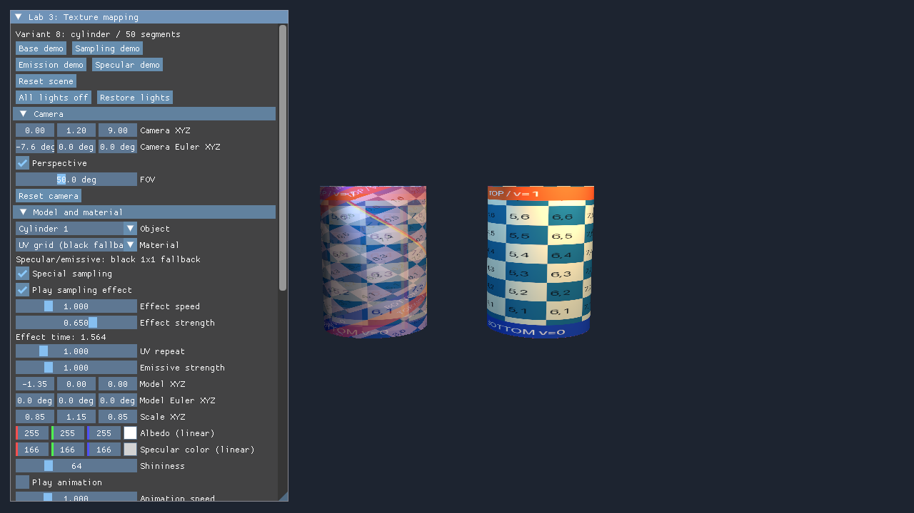
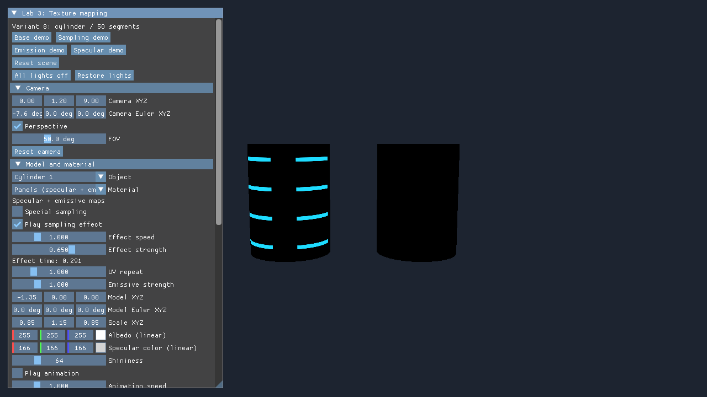

# Черновик отчёта: ЛР3 «Текстурирование»

Структура продолжает Markdown-отчёт ЛР2: условие, метод, результаты, выводы.
Персональные сведения и титульный лист не заполнены: ФИО, группа,
преподаватель и требования оформления не предоставлены. Это технический
черновик, а не окончательно оформленный DOCX/PDF.

## Условие

Добавить к объекту предыдущей работы текстуры из файлов с использованием
стороннего декодера и UV. Вариант 8 — цилиндр из 50 сегментов.
Выполнить общие требования: один dynamic uniform buffer моделей с offsets
при bind, vertex/index данные в GPU-памяти через staging. Реализовать три
дополнения: независимый выбор материалов; анимированное многократное
сэмплирование того же изображения и цветовую модуляцию с push constants;
specular/emissive карты с обязательным чёрным fallback.

## Метод

В самостоятельную папку lab3 скопирована текущая рабочая реализация lab2.
Использованы C++20, Vulkan, GLFW, ImGui, VMA, vk-bootstrap и stb_image.
Собственный набор шести PNG хранится в репозитории; decoder загружает его
при запуске. RGBA данные передаются staging-буфером в optimal VkImage
с DEVICE_LOCAL. Создаются view, sampler и combined image sampler descriptors.
Загрузка синхронизирована барьерами layout/access/stage и отдельным fence.
Геометрия цилиндра, маркеров и конусов также использует staging/copy путь.

Вершины имеют UV: боковина использует развёртку по углу и высоте,
крышки — плоскую проекцию. У шва дублированы позиции и нормали с U=1/0.
Итог — 206 вершин и 600 индексов. Модельные матрицы и материал находятся
в одном dynamic UBO с выровненными записями; material sets разделяются
несколькими объектами. Общая сцена и массивы освещения сохранены из ЛР2.

Fragment shader выбирает albedo по UV, при включённом через push constants
эффекте смешивает две анимированные выборки одного sampler и модулирует цвет.
Specular mask умножает только блик Блинн-Фонга. Emissive слагается после
света. При отсутствии optional-карт в descriptors привязывается загруженный
black.png 1x1. Albedo/emissive — SRGB, specular mask — UNORM.

## Результаты

Рисунок 1. Два экземпляра используют общий материал и dynamic UBO,
сохраняя независимые матрицы.

Рисунок 2. Первый использует две выборки и модуляцию, второй обычную текстуру.
Динамику и паузу следует показывать в работающем приложении.

Рисунок 3. Emissive участки Panels видны без источников; объект с black fallback
остаётся тёмным. Отдельный кадр [specular](docs/screenshots/specular.png)
показывает маску блика и контрольный объект с нулевым specular color.

01.11.2026 выполнена чистая Debug x64-сборка MSVC 19.44, CTest прошёл 1/1,
все пять SPIR-V outputs прошли spirv-val. На AMD Radeon(TM) Graphics
получены DEVICE_LOCAL allocations и dynamic UBO sizeof=176, alignment=16,
stride=176, offsets=0/176. Smoke выполнил 240 итераций с переключением
материалов, освещения и камеры, resize и minimize/restore.
В контрольном окружении validation_errors=0, general_errors=0, status=0.

Проверены отсутствие optional-карт и ошибки обязательной albedo в отдельной
portable-копии. 62 исходных файла lab1/lab2 сохранили SHA-256.
Системный запуск отдельно выявил две устаревшие Steam overlay записи;
контрольный запуск переопределяет поиск implicit layers только в процессе,
сохраняя explicit Khronos и synchronization validation. Реестр не изменялся.
Полные логи и границы проверки: [VERIFICATION](docs/VERIFICATION.md).

## Выводы

Реализован полный путь текстуры от файла до fragment shader и интеграция
с прежним освещением. Разделены выбор модели через dynamic offset и выбор
материала через descriptor set. Проверка диагностического узора помогла
выявить и исправить зеркальное направление U. Показаны различия между
бликом по маске, шириной блика и эмиссией, независимой от внешнего света.
Предыдущие лабораторные сохранены. Перед сдачей нужно добавить персональные
данные и оформить документ по требованиям курса; проверка на NVIDIA и FPS
в результаты не включены.
