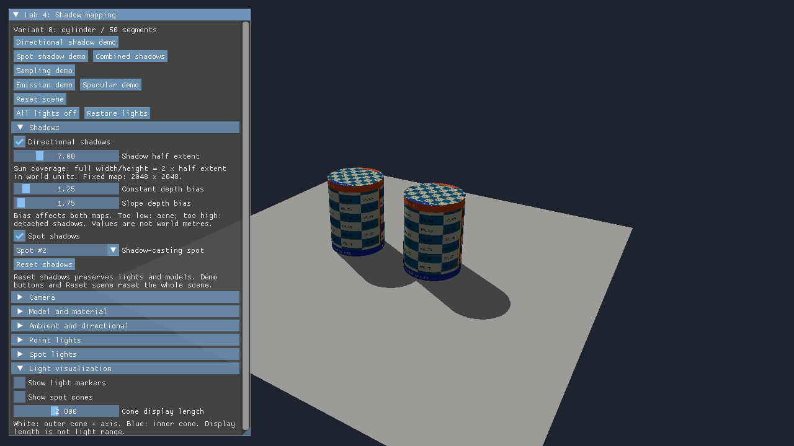
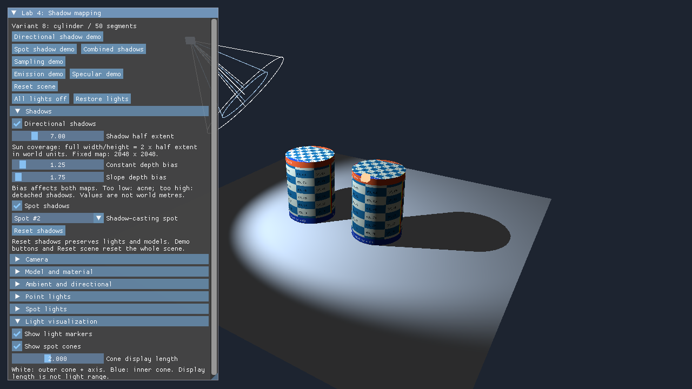
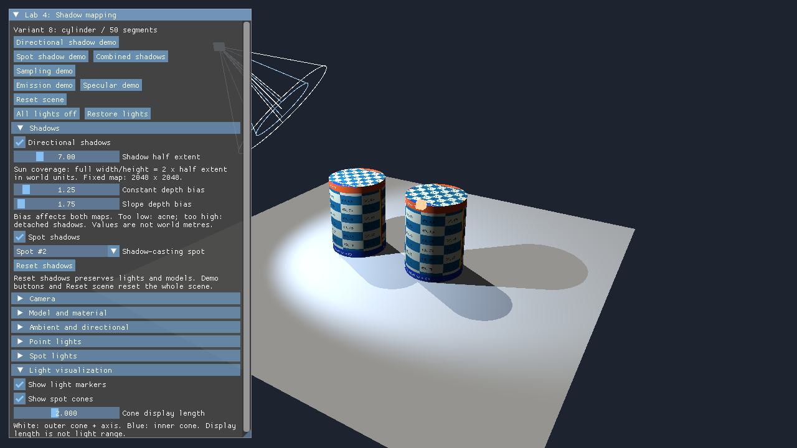

# Черновик отчёта: ЛР4 «Наложение теней»

Вариант 8, цилиндр с 50 сегментами окружности. Порядковый номер студента — 20. ФИО, учебная группа и преподаватель здесь не заполнены: эти сведения не предоставлены. Образец оформления отчёта отсутствует.

## Условие

Добавить shadow mapping к сцене ЛР3: каждый кадр рендерить depth-текстуру через Dynamic Rendering, использовать отдельный depth-only pipeline и comparison sampler LESS, обеспечить ортографическую проекцию направленного света и управление покрытием/bias. Пол должен принимать настоящую тень цилиндров. Дополнительная часть — тень одного выбираемого прожектора с перспективной light projection.

Текст условия взят из предоставленного Markdown-задания; исходный PDF недоступен для непосредственной сверки.

## Метод

Сцена скопирована в самостоятельную lab4. Добавлена третья модель — пол. Цилиндры и пол используют общий dynamic model UBO и одинаковые matrices/mesh ranges в main/shadow passes. Для солнца и spot созданы отдельные depth images 2048² и comparison samplers. Формат D32_SFLOAT выбран после проверки свойств GPU.

На первом этапе кадра геометрия проектируется в depth map каждого активного источника. Для солнца используется orthographic × LookAt, для spot — perspective с FOV=2×outerHalfAngle × LookAt. Затем основной fragment shader проецирует worldPosition в пространство соответствующего света и сравнивает глубину через sampler2DShadow. Visibility ограничивает direct diffuse/specular только данного источника. Ambient и emissive сохраняются независимо.

Синхронизация выполнена image barriers между depth attachment writes и fragment sampled reads. CPU обновляет общие buffers после fence предыдущего кадра. При удалении spot стабильный ID сопоставляется с актуальным vector, а не используется старая ссылка.

## Результаты

Самостоятельная Debug сборка и CPU test прошли. Все 6 SPIR-V файлов прошли spirv-val. На NVIDIA RTX 3050 Laptop GPU, API 1.3.289, core Dynamic Rendering, выполнен 240-frame runtime-сценарий без validation/synchronization errors при изоляции сторонних implicit layers. За 60 кадров статичного combined режима каждая карта перерисована 60 раз. Хеши 114 исходных файлов предыдущих лабораторных совпали.

Кадры захвачены из работающего приложения. Сравнение On/Off выявило 12013 изменённых пикселей для солнца и 14611 для spot без солнца. Полные условия запуска, логи, ограничения и проблема системных Steam overlay manifests приведены в [docs/VERIFICATION.md](docs/VERIFICATION.md).

## Выводы

Shadow mapping добавляет проверку препятствий между поверхностью и источником поверх модели отражения ЛР3. Отдельные карты позволяют независимо затенять вклад каждого света. Качество зависит от разрешения, покрытия и bias: эти параметры решают разные задачи. Реализованы базовые тени солнца и дополнительная тень выбранного spot; point shadows, PCF и каскады не реализованы.

Это черновик Markdown для подготовки к защите; оформление по шаблону учебного заведения и исходный PDF ещё не сверены. Оценка преподавателя не прогнозируется.
